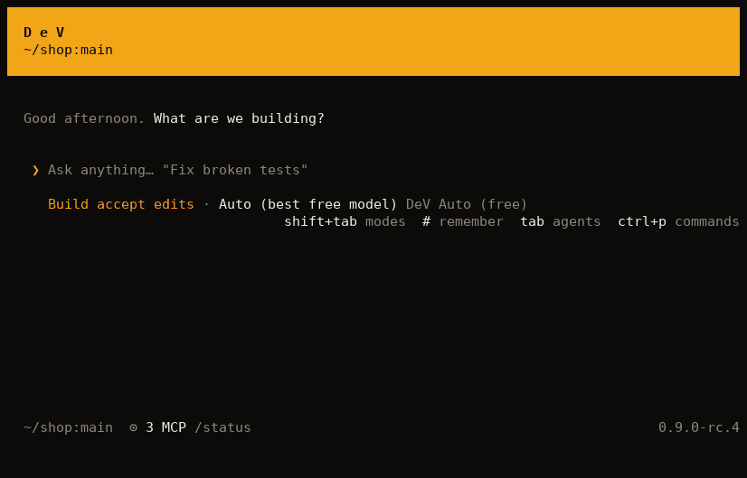

<div align="center">


# DeV

**Premium AI for everyone.**

DeV brings premium AI to anyone, with nothing to pay: an assistant on your computer, a coding agent in your terminal, and help in your browser. DeV Code, the coding agent, comes first.

[Website](https://trydev.work) · [Docs](https://trydev.work/docs.html) · [Roadmap](docs/ROADMAP.md) · [Report a bug](https://github.com/Harsha-code-per/DeV/issues/new/choose) · [Sponsor](#support-dev)

[](LICENSE) [](#install) [](#why-dev)



</div>

## Why DeV

Great tools shouldn't depend on what you can pay. A student, a freelancer and a team on a tight budget deserve the same tools as anyone else.

DeV includes the features that usually sit behind a paid plan, for everyone. There's no subscription and no card to add. It's open source under the MIT licence, so you can use it in your commercial work.

## The DeV family

| Product | What it is | Get it | Status |
|---|---|---|---|
| **DeV Code** | A coding agent for your terminal. Create projects and build software. | `curl`, npm, pnpm or bun | Available now |
| **DeV** | An assistant for Windows, macOS and Linux that runs in the background, wakes to your voice and works across your computer. | Installers: `.exe`, `.dmg` and Linux packages | In development |
| **DeV for Chrome** | A browser extension that helps you debug and get things done on any page. | Browser extension | In development |
| **DeV for Web** | A chat site where anyone can talk to free AI models, with nothing to install. | Your browser | Planned |

## Install DeV Code

**Linux and macOS**

```sh
curl -fsSL https://trydev.work/install | sh
```

**Windows (PowerShell)**

```powershell
irm https://trydev.work/install.ps1 | iex
```

**npm**

```sh
npm i -g @devcodeagent/cli
```

**pnpm**

```sh
pnpm add -g @devcodeagent/cli
```

**bun**

```sh
bun add -g @devcodeagent/cli
```

Every method checks the download against the release's SHA-256 checksums before installing anything.

## Quick start

**1. Start DeV Code in your project.**

```sh
devcode
```

**2. Connect a model.** Type this inside DeV Code. Providers with a free tier are listed first.

```text
/connect
```

**3. Say what you want built.** DeV picks how to work, and you can change it at any time with Shift+Tab.

## Features

| Feature | What you get |
|---|---|
| **Plans you approve** | For larger work, DeV reads the code and writes a plan. Nothing changes until you say yes. |
| **Goals it finishes** | Ask it to keep going until the tests pass. An independent reviewer checks the result before the goal ends. |
| **Work it can prove** | DeV runs your tests or build before saying a task is done. Every finished task ends in a receipt. |
| **Live status** | A bar at the top always says what DeV is doing, and which step of the plan it's on. |
| **Subagents** | Focused helpers take on parts of a task, in parallel or in the background. Add `isolation: worktree` to an agent's file and it works in a git worktree of its own. |
| **Rewind** | Go back to any earlier message and restore both the conversation and your files. |
| **Project memory** | DeV keeps what it learns about your project in `DEV.md`, a file you can read and edit. |
| **OS sandbox** | Optional, as in Claude Code. Turn it on with `"sandbox": { "enabled": true }` and, on Linux and macOS, shell commands can't read your SSH keys or cloud credentials. Off by default, so commands use your logins (`gh`, cloud CLIs) and network like your own terminal. |
| **Free model routing** | `auto/free` moves between the free models you've connected and learns which ones work for you. |
| **Built to extend** | Skills, plugins, hooks, custom agents and MCP servers are all included. |

## Modes

| Mode | What happens |
|---|---|
| **Manual** | DeV asks before it edits files or does anything risky. With the sandbox on, commands inside it run without asking. |
| **Accept edits** | File edits go ahead, and everything else asks as usual. |
| **Plan** | DeV writes a plan and changes nothing until you approve it. |
| **Auto** | DeV never asks. Risky actions (deleting folders, force pushes, publishing, `sudo`, writing outside the project, secrets files) are refused and DeV finds another way. If DeV really needs one and tries it again, you're asked, as you are after three refusals in a row or twenty in a session. To let one through from now on, allow it in `/permissions`. |
| **Goal** | Auto, and DeV keeps working on your next message until it is true and a separate reviewer confirms it. Also `/goal <objective>`, or `devcode run --auto "/goal <objective>"` in scripts. An unfinished goal comes back when you continue the session. |

Shift+Tab cycles them in that order, and a shell command's permission prompt can approve it and switch to Auto. Start in one with `--permission-mode manual|accept-edits|plan|auto|goal`, or `--auto`.

## Commands

| Command | What it does |
|---|---|
| `/connect` | Add a model provider |
| `/models` | Choose a model |
| `/goal <objective>` | Keep working until something is true |
| `/steps` | Open or fold the steps of finished tasks |
| `/init` | Write a `DEV.md` for this project |
| `/rewind` | Go back to an earlier message, or summarize everything before it |
| `/autocompact` | Set how full the conversation gets before DeV compacts it |
| `/plugins` | Manage skills, plugins and MCP servers |
| `/permissions` | Change the mode, allow what Auto mode refused, and edit rules |
| `/add-dir` | Let DeV work in another folder |
| `/hooks` | See the hooks you have set up |
| `/keybindings`, `/statusline` | Edit keybindings and the status line in `tui.json` |
| `/tasks` | See the session's subagents and open one |

Run a single prompt from a script:

```sh
devcode run "explain this repo"
```

Get the result as JSON:

```sh
devcode -p "fix the failing test" --output-format json
```

Work in a git worktree of its own, so parallel sessions don't collide:

```sh
devcode -w fix-login
```

The [docs](https://trydev.work/docs.html) cover configuration, free models and security.

## How we build it

- **Measured, not claimed.** We test DeV on [real coding tasks](bench/README.md) with hidden tests it never sees. It passes 27 of 30 on free models, at no cost.
- **Tested as you get it.** Every release is installed on clean Linux, macOS and Windows machines.
- **Secure by default.** We treat the model as untrusted. Read how in [SECURITY.md](SECURITY.md).

Model providers set their own free limits and terms. Windows doesn't have a sandbox yet.

## Support DeV

DeV is built without funding, on free tools and free tiers. If you'd like to see it grow faster, please [sponsor the project](https://github.com/sponsors/Harsha-code-per). Every sponsorship goes into building DeV, and DeV stays free for everyone.

You can also help by starring the repo, reporting bugs and telling other developers.

See where we're heading on the [roadmap](docs/ROADMAP.md).

## Contributing

Bug fixes, docs and new ideas are all welcome. Start with [CONTRIBUTING.md](CONTRIBUTING.md) and the [Code of Conduct](CODE_OF_CONDUCT.md). Please report security issues privately, as described in [SECURITY.md](SECURITY.md).

## Credits

DeV Code builds on [OpenCode](https://github.com/anomalyco/opencode), and we're grateful to its authors. Third-party notices are in [NOTICE](NOTICE).

## License

[MIT](LICENSE)
